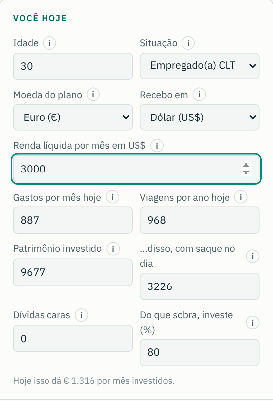
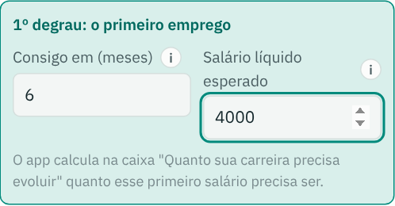
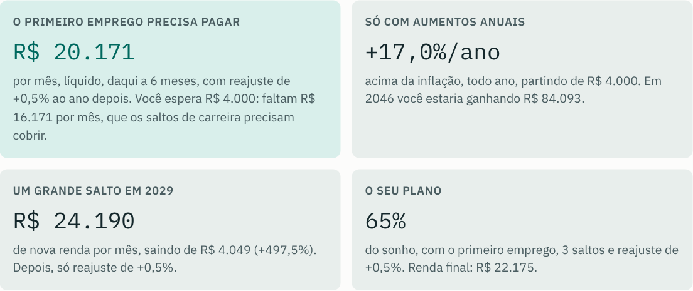
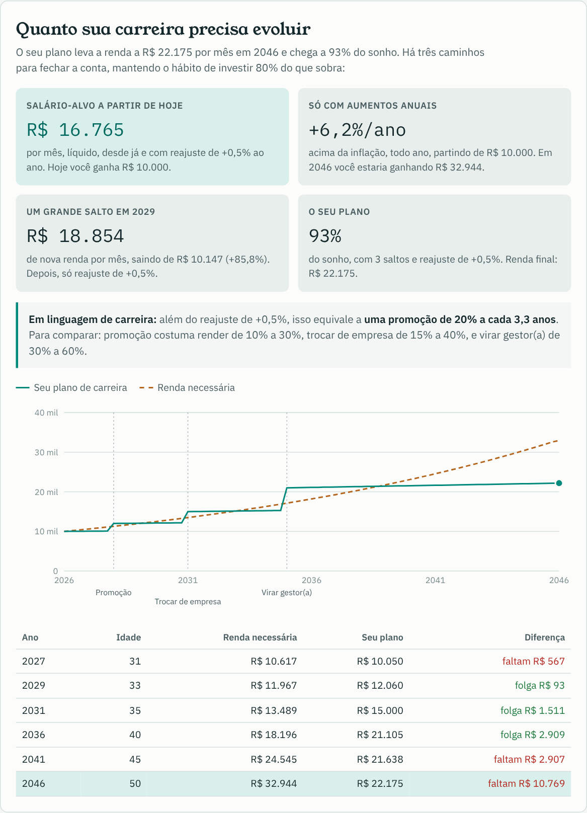
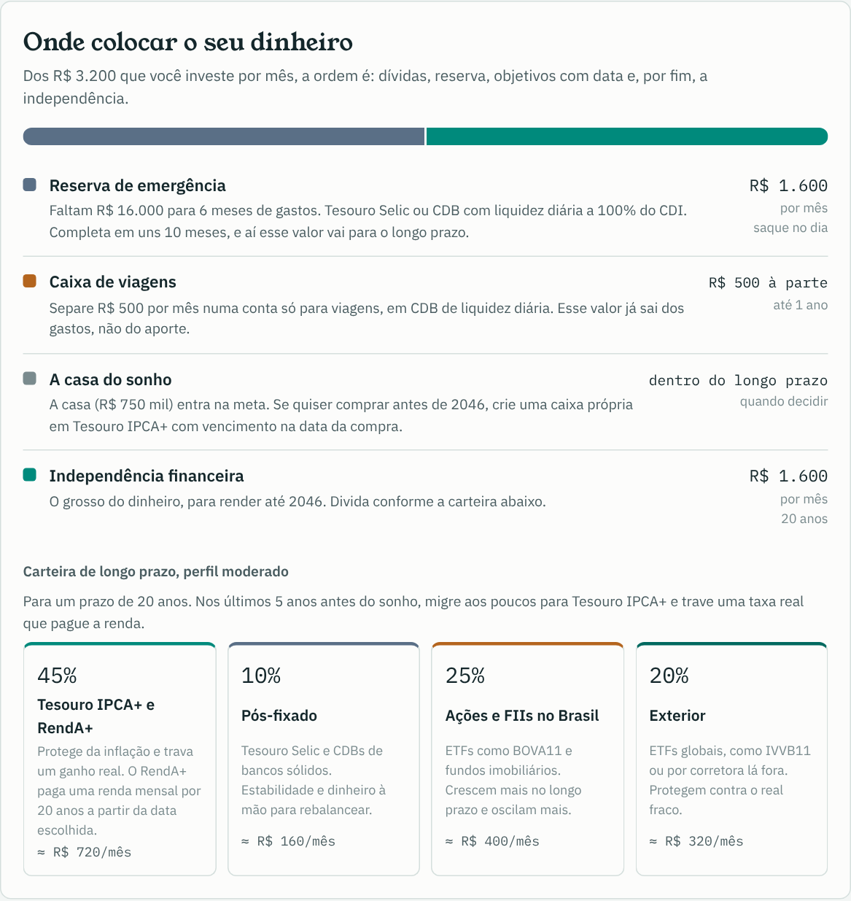
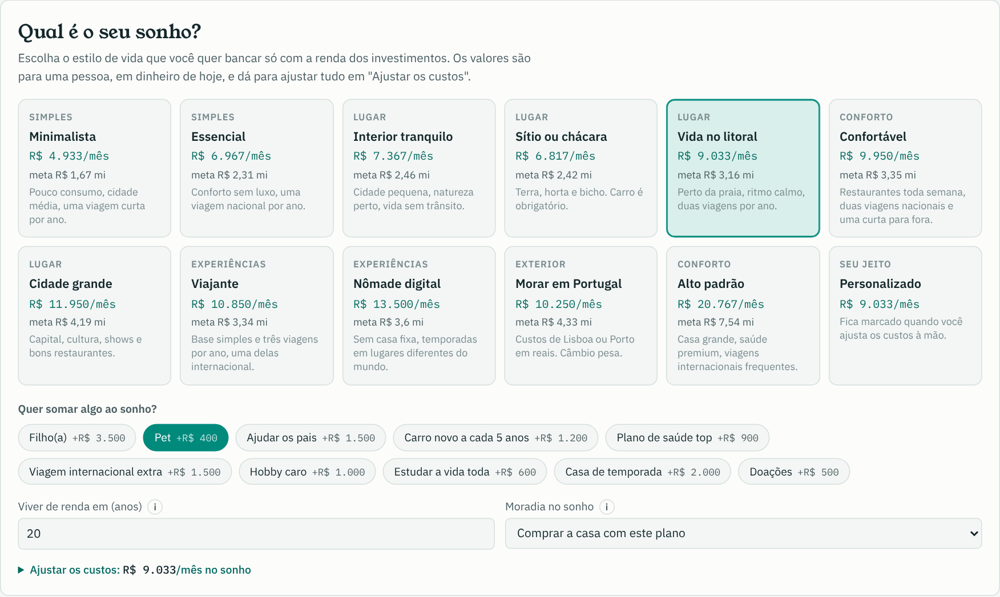

# Novidades do Planeja Lar

## 25 de outubro de 2026

### 💶 Euro e dólar

Dá para fazer o plano em **real, euro ou dólar**. A **Moeda do plano** muda todos os valores da tela, do sonho aos resultados. O campo **Recebo em** serve para quem trabalha para fora e recebe em outra moeda. O câmbio fica nas premissas e pode ser atualizado com a cotação do dia.

- Com o sonho em euro ou dólar, a carteira sugere uma parte maior no exterior
- O plano de ação ganha o item **Proteger-se do câmbio**, com dicas para quem ganha fora, gasta fora ou os dois

### 🪜 Saltos de carreira em reais e o primeiro emprego

Os saltos de carreira agora pedem a **nova renda em reais**, e o app mostra ao lado quanto isso representa de aumento ("de R$ 10.096 para R$ 12.000, +18,9%").

Para quem está **sem emprego**, o primeiro degrau é o **primeiro emprego**: em quantos meses e com que salário. O app responde **quanto esse primeiro emprego precisa pagar** para chegar ao sonho e quanto os saltos seguintes precisam cobrir.

 

### 🎯 Um plano para uma pessoa

O Planeja Lar foi refeito do zero para planejar a vida de **uma pessoa** e responder três perguntas.

**Quanto minha carreira precisa evoluir?** O app mostra o salário-alvo, o aumento anual necessário e de quanto precisa ser um grande salto, tudo traduzido em linguagem de carreira ("equivale a uma promoção de 20% a cada 3,3 anos").

**Onde coloco o meu dinheiro?** Cada real do aporte ganha um destino, em ordem: dívidas, reserva de emergência, caixa de viagens, educação do filho e independência. Embaixo, a carteira de longo prazo para o seu perfil e prazo.

**Qual é o meu sonho?** São 11 cartões de estilo de vida, cada um com o custo por mês e o patrimônio que exige:

- Simples: Minimalista e Essencial
- Lugares: Interior tranquilo, Sítio ou chácara, Vida no litoral e Cidade grande
- Experiências: Viajante e Nômade digital
- Exterior e conforto: Morar em Portugal, Confortável e Alto padrão
- Extras para somar: filho, pet, ajudar os pais, carro novo, plano de saúde top, viagem internacional, hobby, estudos, casa de temporada e doações
- Moradia: comprar a casa com o plano, já ter a casa ou morar de aluguel

## 23 de outubro de 2026

### 🏡 Primeira versão

A primeira versão do Planeja Lar, feita para casais:

- 💑 Renda, patrimônio e aporte separados para cada pessoa, com a divisão do esforço proporcional ao salário, à sobra ou meio a meio
- 🏠 Gastos de cada um até o ano em que vão morar juntos, mais o custo de montar a casa
- 📈 Quanto a renda precisa crescer para chegar à meta, com marcos a cada 5 anos
- 🧳 Estilos de vida pré-definidos e uma caixa de viagens separada da reserva
- 💼 Cuidados para quem é PJ: reserva maior, INSS sobre o pró-labore e licença-maternidade
- 🔒 Compartilhar o plano por link protegido por senha
- ℹ️ Um botão **i** com explicação simples em cada campo
- ⚖️ Aviso legal no app e no README
